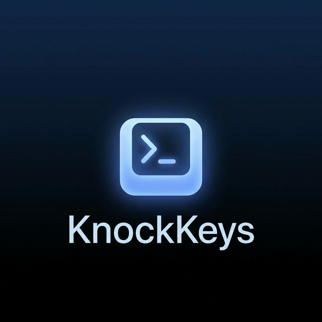

<div align="center">
  

  <br>

  # KnockKeys
  **The Ultimate Terminal Typing Experience**

  [](https://www.rust-lang.org/)
  [](https://github.com/ratatui-org/ratatui)
  [](LICENSE)

  <p align="center">
    A fully offline, adaptive typing trainer inspired by keybr.com.<br>
    Built for speed, privacy, and mastery.
  </p>
</div>

---

## ✨ Features

KnockKeys brings a premium, distraction-free typing experience directly to your terminal.

| feature | description |
| :--- | :--- |
| **🚀 Adaptive Learning** | Dynamic algorithms focus on your weak keys to optimize improvement. |
| **🔒 100% Offline** | No data collection. Your progress stays on your machine. |
| **🤖 AI Analytics** | Optional Groq/OpenAI integration for deep insights into your typing habits. |
| **📊 Rich Metrics** | Detailed stats, WPM sparklines, and session recaps. |
| **🎨 Beautiful Themes** | Choose from Ocean, Ember, Forest, Slate, Solarized, and Neon. |
| **👨‍💻 Code Drill** | Practice typing actual code syntax in Rust, Python, Go, C++, and C. |

<br>

## 🚀 Getting Started

### Prerequisites

- **Rust & Cargo**: Ensure you have the Rust toolchain installed.
- **Terminal**: A modern terminal emulator (iTerm2, Alacritty, Ghostty, etc.) with Nerd Font support recommended.

### Building from Source

```bash
# Clone the repository
git clone https://github.com/Sohampatra1/KnockKeys.git
cd KnockKeys

# Build for release
cargo build --release
```

### Running the App

```bash
./target/release/typetrainer
```

<br>

## 🧠 AI-Powered Insights

Unlock the **Typing Guru AI Report** to get personalized feedback on your typing form.

1.  **Configure API Key**: The project now supports a local `.env` file.
    Create a `.env` file in the root directory (already configured if you used the setup script):

    ```env
    GROQ_API_KEY="gsk_..."
    ```

    *Alternatively, export it in your shell:*

    ```bash
    export GROQ_API_KEY="your_key_here"
    ```

2.  **Launch**: Run the app, and select **"Typing Guru AI Report"** from the main menu.

    > **Note**: You can also override the model and URL:
    > ```bash
    > export TYPETRAINER_GROQ_MODEL="gpt-oss-120b"
    > export TYPETRAINER_GROQ_URL="https://api.groq.com/openai/v1/chat/completions"
    > ```

<br>

## 🛠️ CLI Utilities

KnockKeys isn't just a TUI; it's a powerful CLI tool for managing your data.

- **Export Stats**:
  ```bash
  ./target/release/typetrainer export-csv
  ```

- **Backup Data**:
  ```bash
  ./target/release/typetrainer backup
  ```

- **Import Backup**:
  ```bash
  ./target/release/typetrainer import ~/.typetrainer/backups/progress-YYYYMMDD-HHMMSS.json
  ```

<br>

## 📂 Data Storage

Your privacy is paramount. All data is stored locally:

- **Progress**: `~/.typetrainer/progress.json`
- **Backups**: `~/.typetrainer/backups/`
- **CSV Exports**: `~/.typetrainer/exports/`

---

<div align="center">
  <sub>Designed with ❤️ by Soham using Rust and Ratatui.</sub>
</div>
